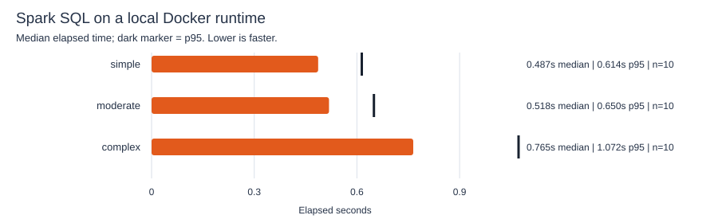
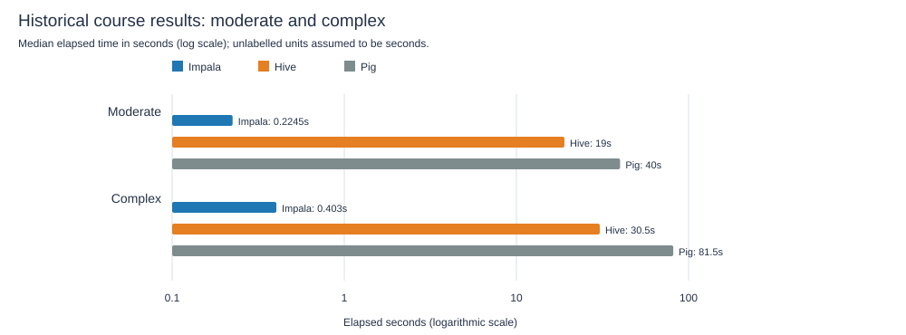

# LakehouseBench

[](https://github.com/mkayara/lakehousebench/actions/workflows/ci.yml)


A reproducible Spark SQL benchmark and results dashboard. The benchmark builds
a deterministic Parquet dataset, runs three query shapes, checks result
consistency, and preserves every timed run with its runtime metadata. Archived
Hive, Impala, and Pig course measurements are included as historical context,
not presented as a modern head-to-head comparison.

## Start here

**The dashboard is the user-facing entry point.** The recommended way to get a
complete view is to run the benchmark once, then start the dashboard. Run both
commands from the repository root in PowerShell:

```powershell
docker compose --profile spark run --build --rm spark-benchmark
docker compose up --build dashboard
```

Open [http://localhost:8501](http://localhost:8501). The dashboard has separate
views for the modern Spark run and the historical course results. The first
benchmark normally takes longer than subsequent runs because Docker must build
the Spark image.

If port 8501 is already occupied, set a different host port before starting the
dashboard:

```powershell
$env:DASHBOARD_PORT = "8502"
docker compose up --build dashboard
```

Then open [http://localhost:8502](http://localhost:8502).

To open the dashboard **before** running the benchmark, that is fine: it will
show the command to generate Spark results. To run the dashboard directly on
your machine instead of in Docker:

```powershell
python -m pip install -e .
streamlit run app/dashboard.py
```

Use `streamlit run`, **not** `python app/dashboard.py`; Streamlit needs its own
runner to initialize the interactive web app. The Spark workload itself runs
inside its pinned Docker image and does not require PySpark in the dashboard's
Python environment.

### Change benchmark size or repetition count

```powershell
$env:BENCHMARK_ROWS = "1000000"
$env:BENCHMARK_WARMUPS = "3"
$env:BENCHMARK_REPETITIONS = "15"
$env:BENCHMARK_CACHE_POLICY = "uncached"
docker compose --profile spark run --build --rm spark-benchmark
```

Defaults are 100,000 generated rows, two warm-ups, ten timed repetitions, and
Spark's in-memory cache disabled. Use `cached` to persist the event table in
Spark memory. Each invocation gets its own benchmark ID; all raw runs are
appended to [`results/spark-results.jsonl`](results/spark-results.jsonl).

## Current Spark result

This checked-in run used **Spark 4.2.1**, `local[*]`, 100,000 generated
Parquet rows, 2 warm-ups and 10 timed repetitions per workload, with Spark's
in-memory cache disabled. It ran in a local Docker container under WSL2 with
12 CPUs visible to the container and four shuffle partitions. These are local
development-machine measurements, not cluster throughput claims.

| Workload | Operation | Runs | Median (s) | P95 (s) | Min (s) | Max (s) |
| --- | --- | ---: | ---: | ---: | ---: | ---: |
| Simple | Filter and count | 10 | 0.487 | 0.614 | 0.423 | 0.615 |
| Moderate | Group, aggregate and sort | 10 | 0.518 | 0.650 | 0.377 | 0.669 |
| Complex | Join, filter, group and sort | 10 | 0.765 | 1.072 | 0.617 | 1.202 |



The join-and-aggregate query was slowest in this run. The spread between median
and p95 is also visible, especially for that workload; the raw samples are
committed so the chart and summary can be independently checked. This result is
a demonstration of the harness, not proof that Spark is faster than another
engine.

## Historical course results

The original spreadsheets recorded 10 runs per engine and workload. The table
shows median elapsed times converted to seconds. A `*` marks units assumed to
be seconds because the source sheet did not state a unit.

| Workload | Hive (s) | Impala (s) | Pig (s) |
| --- | ---: | ---: | ---: |
| Simple | 0.0000695† | 0.199* | 8.095 |
| Moderate | 19 | 0.2245* | 40* |
| Complex | 30.5 | 0.403* | 81.5* |



**Do not rely on the simple-workload ranking.** Hive's simple-query column is
labelled milliseconds, while the other simple timings are in seconds or have
no stated units. The table converts Hive's label literally (`†`); if that
label is wrong, the apparent ranking changes dramatically. The moderate and
complex Hive sheets label seconds; Impala and Pig units are assumed as marked.
The source does not establish equivalent query plans, hardware, cache state,
or warm-up conditions, so even those comparisons are descriptive rather than
controlled.

The dashboard's **Historical course results** view and the analysis CLI use the
same underlying checked-in observations:

```powershell
python -m pip install -e ".[dev]"
python -m lakehousebench analyze --data data/observations.csv --output reports
```

To rebuild the historical CSV from the supplied workbooks, place copies of
`Experiment Data - HIVE.xlsx`, `Experiment Data - PIG.xlsx`, and
`Experiment Data - IMPALA.xlsx` in a folder and run:

```powershell
python scripts/import_workbooks.py --input-dir "C:\path\to\workbooks" --output data/observations.csv
```

## How the benchmark works

1. Generate deterministic event and customer data with Spark.
2. Write the event data to temporary Parquet and read it back for the SQL runs.
3. Warm up each workload, then time each action that collects its result.
4. Record the SQL fingerprint, elapsed seconds, result row count and SHA-256
   checksum, Spark/runtime metadata, workload size, and cache policy.
5. Summarize repeated samples with median and p95; keep every raw run.

The workloads are a filtered count, a grouped aggregate, and a filtered join
with aggregation. Every repetition of a workload in a benchmark run must
produce the same result checksum. The queries are synthetic demonstrations,
not reconstructions of the course assignment queries.

### Rebuild the README charts

```powershell
python scripts/generate_readme_assets.py
```

The chart generator reads the committed raw Spark observations and historical
CSV. The historical chart uses a logarithmic axis to keep the engines visible
on the same plot; the unit caveats above still apply.

## Project layout

| Path | Purpose |
| --- | --- |
| `app/dashboard.py` | Streamlit application entry point |
| `spark/benchmark.py` | Spark SQL workloads and raw result capture |
| `docker-compose.yml` | Dashboard and optional Spark benchmark services |
| `data/observations.csv` | Tidy archival Hive, Impala and Pig measurements |
| `results/spark-results.jsonl` | Raw samples from the documented Spark run |
| `scripts/import_workbooks.py` | Explicitly mapped workbook-to-CSV importer |
| `scripts/generate_readme_assets.py` | Regenerates README result charts |
| `src/lakehousebench/` | Historical-data validation, analysis and CLI |
| `tests/` | Analysis, import and dashboard regression tests |

## Engineering decisions and limitations

- Spark is pinned in Docker (`apache/spark:4.2.1-python3`); the dashboard has a
  separate lightweight Python image.
- Benchmark IDs keep separate invocations distinct. Cache policy and warm-up
  count are recorded rather than hidden.
- Checksums detect changed outputs, but are not a formal correctness proof for
  the SQL itself.
- `uncached` disables Spark's in-memory cache; it does not flush operating
  system or filesystem caches.
- Spark runs in local mode, not on a distributed cluster. Wall-clock time
  depends on machine, container resources, filesystem state, and runtime.
- The historical workbooks have incomplete or inconsistent units and do not
  prove controlled, equivalent workloads.
- HBase is intentionally not included in the SQL-engine ranking. A useful
  HBase comparison would separately measure point lookups, batch gets, and
  writes with throughput and latency percentiles.

## Tests

```powershell
python -m pip install -e ".[dev]"
python -m pytest
```

## License

MIT for the code in this repository. Historical benchmark observations were
transcribed from the user-provided workbooks; the original course report and
student identities are not redistributed.
